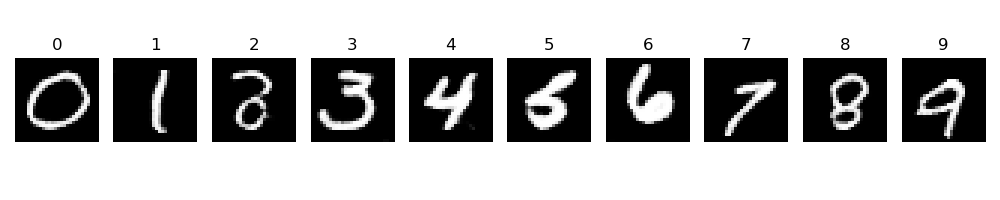
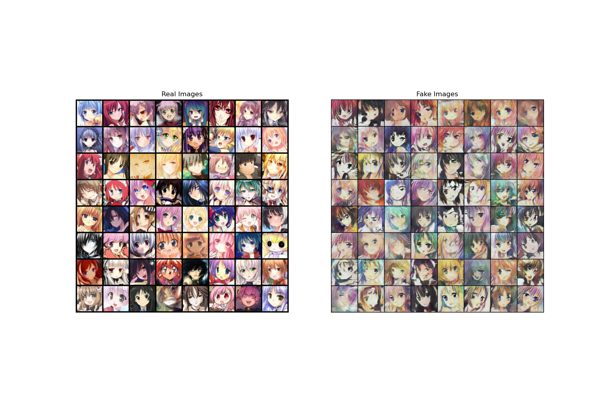

# Digits & Faces GAN Lab

使用 PyTorch 实现的图像生成学习项目，包含两个可独立运行的实验：按类别生成 MNIST 手写数字，以及从随机噪声生成动漫头像。

| 实验 | 模型 | 输出 | 运行入口 |
| --- | --- | --- | --- |
| 手写数字生成 | 条件卷积 GAN（cDCGAN） | 28 × 28 灰度图，可指定 0–9 类别 | `main.py` |
| 动漫头像生成 | DCGAN | 96 × 96 RGB 图像 | `test.py` |

## 效果预览

### 手写数字

下图按 0–9 的类别顺序展示生成结果：



### 动漫头像

左侧为真实训练样本，右侧为生成结果：



以上图片为已有实验记录。项目未固定随机种子，不同运行的结果会有差异。

## 快速开始

### 1. 安装依赖

下载项目后，在项目根目录打开终端，使用独立 Python 环境安装依赖：

```bash
python -m pip install torch torchvision numpy pandas matplotlib pillow
```

程序自动选择可用的 CUDA GPU，否则使用 CPU。训练建议使用 GPU。项目暂未提供锁定版本的环境文件。

### 2. 准备数据

两个实验可以分别运行，只需下载对应实验的数据。仓库不附带原始数据和预训练权重。

```text
data/
├── mnist_train.csv       # 手写数字实验
└── faces/               # 动漫头像实验
    ├── image_001.jpg
    ├── image_002.jpg
    └── ...
```

**动漫头像：**从 [AnimeFaces（Kaggle）](https://www.kaggle.com/datasets/xxc025/animefaces) 下载并解压，将图片直接放入 `data/faces/`。该链接仅对应动漫头像数据。

头像读取器只扫描 `faces/` 第一层目录，支持小写扩展名 `.jpg`、`.jpeg`、`.png`、`.bmp` 和 `.webp`。请使用正方形图片，当前预处理会将其缩放为 96 × 96；非正方形图片可能导致尺寸不匹配。

**MNIST：**可从 [MNIST in CSV（Kaggle）](https://www.kaggle.com/datasets/oddrationale/mnist-in-csv) 获取 CSV 格式数据，将训练集保存为 `data/mnist_train.csv`。读取器要求：

- 每行 785 列，第一列为数字标签（0–9），其余 784 列为像素值（0–255）。
- 文件不含表头；如果下载文件包含列名，请先删除首行表头。
- 当前实验只使用训练集，无需下载测试集。

### 3. 运行实验

在项目根目录运行手写数字实验：

```bash
python main.py
```

或运行动漫头像实验：

```bash
python test.py
```

`test.py` 是动漫头像训练脚本。两个脚本均从头训练，训练完成后通过 Matplotlib 窗口展示损失曲线和生成结果；关闭当前绘图窗口后，可继续查看后续图像。需要可显示图形窗口的运行环境。

## 训练参数

参数在对应脚本顶部修改：

| 参数 | MNIST（`main.py`） | 动漫头像（`test.py`） |
| --- | --- | --- |
| 训练轮数 `EPOCHS` | 12 | 20 |
| 批大小 `BATCH_SIZE` | 128 | 128 |
| 学习率 `LR` | 0.0002 | 0.0002 |
| Adam `BETAS` | (0.5, 0.999) | (0.5, 0.999) |
| 噪声维度 | 100 | 100 |
| 标签平滑 | 真标签 0.8–1.0，假标签 0–0.2 | 默认关闭 |

两个数据加载器均设置 `drop_last=True`，数据量至少需要达到一个批次；使用小样本时，可相应调小 `BATCH_SIZE`。动漫头像脚本默认 `NUM_WORKERS=0`。

## 项目结构与阅读顺序

```text
.
├── README.md
├── main.py              # MNIST 条件卷积 GAN
├── dataset.py           # MNIST CSV 读取与 one-hot 编码
├── test.py              # 动漫头像 DCGAN
├── 对抗神经网络.md        # 原理、张量形状与训练流程
├── .gitignore
└── *.png                # 已有实验结果
```

建议先阅读 [原理与实现说明](对抗神经网络.md)，再查看 `dataset.py` 的数据处理、`main.py` 的条件输入方式，最后对照 `test.py` 理解无条件图像生成。

损失曲线：[MNIST 判别器](D_Loss.png)、[MNIST 生成器](G_Loss.png)、[动漫头像训练](小数据集train-loss.png)。

## 常见问题

**提示找不到 CSV 或没有找到图片**

确认终端工作目录为项目根目录，并检查数据路径。头像图片应直接位于 `data/faces/`，不能再嵌套一层解压目录。

**MNIST 读取时出现类型转换错误**

检查 CSV 是否含表头，以及每行是否满足“1 个标签 + 784 个像素”的格式。

**显存不足**

调小脚本顶部的 `BATCH_SIZE`，再重新运行。训练速度取决于硬件和数据量。

## 实现范围

项目用于学习 GAN 的网络结构、条件输入和交替训练流程。当前脚本不保存模型权重，也不提供加载权重的独立推理入口。`main.py` 在导入时会加载数据并开始训练，请直接作为脚本运行。

MNIST 的最终展示使用 `eval()`；动漫头像训练期间的预览仍使用训练模式下的生成器。已有结果图仅供观察，不提供 FID 等定量评估，不能仅凭损失曲线判断生成质量。

## 数据说明

数据集由读者从上述来源自行获取，使用条件以对应数据集页面为准。头像对比图包含真实训练样本，来源为 AnimeFaces 数据集。数据目录、下载压缩包、缓存和常见凭据文件已通过 `.gitignore` 排除。

